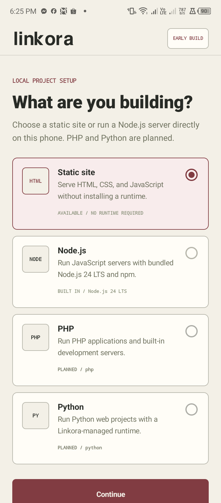
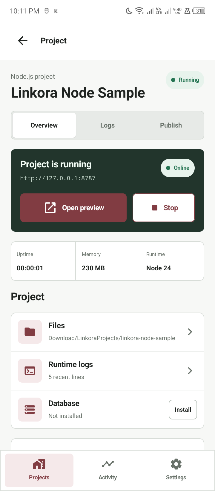
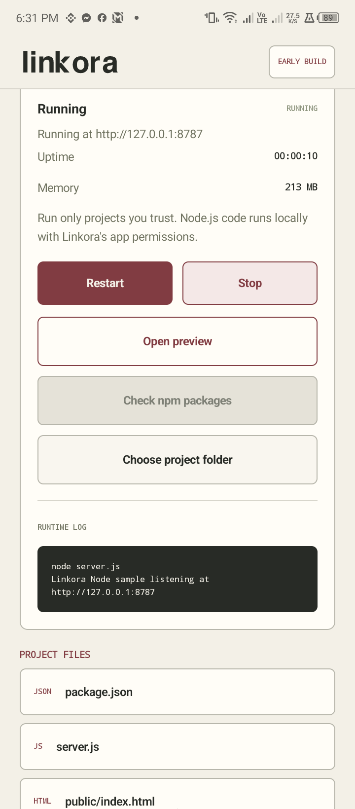

<!-- markdownlint-disable MD033 MD041 -->

<div align="center">


# Linkora Mobile

**A local-first Android workspace for running and publishing web projects.**

Open a real project folder, run it on your phone, inspect logs and resource
use, then decide whether it stays local or goes online.

<p>
  <a href="https://linkora.top/downloads/linkora-mobile-v0.7.0.apk">
    
  </a>
  <a href="https://linkora.top/mobile">
    
  </a>
  <a href="https://github.com/x1n-Q/linkora-android/releases/tag/v0.7.0">
    
  </a>
</p>

<p>
  
  
  
  <a href="LICENSE">
    
  </a>
</p>

</div>

## Overview

Linkora Mobile turns an Android phone into a lightweight project runtime. It
can create or open real project folders, run supported web stacks, show logs
and resource use, and keep a project active through an Android foreground
service.

A Linkora account is optional. **Standalone mode works without `linkora.top` or
any Linkora service.**

## Interface

<table>
  <tr>
    <td width="33%" align="center">
      <a href="fastlane/metadata/android/en-US/images/phoneScreenshots/1.png">
        
      </a>
    </td>
    <td width="33%" align="center">
      <a href="fastlane/metadata/android/en-US/images/phoneScreenshots/2.png">
        
      </a>
    </td>
    <td width="33%" align="center">
      <a href="fastlane/metadata/android/en-US/images/phoneScreenshots/3.png">
        
      </a>
    </td>
  </tr>
  <tr>
    <td align="center"><strong>Projects</strong></td>
    <td align="center"><strong>Runtime controls</strong></td>
    <td align="center"><strong>Runtime Manager</strong></td>
  </tr>
</table>

## What it does

- Create a project or open an existing folder through Android Files
- Host static sites directly from the phone
- Run Node.js and PHP projects through separately installed Runtime Packs
- Add an optional local MariaDB server and inspect its databases in the app
- Start, stop, restart, preview, and inspect project logs from one workspace
- Keep projects running in the background with a persistent notification
- Limit access to the phone, share on the local network, or publish a project
- Use a Linkora address only when the user chooses to connect an account
- Keep account tokens encrypted with Android Keystore

## Install

Linkora Mobile `0.7.0` supports Android 8.0 and later.

1. [Download the signed APK](https://linkora.top/downloads/linkora-mobile-v0.7.0.apk).
2. Open the downloaded file.
3. Allow installation from the browser or file manager when Android asks.
4. Open Linkora Mobile and choose how the project should be published.

The base app can host static projects on any supported Android CPU
architecture. Current Node.js, PHP, MariaDB, and connector Runtime Packs are
available for 64-bit ARM devices (`arm64-v8a`).

### Verify the release

- **APK SHA-256**
  `32b74ad04994cb0952c3f5865bf4ec230fecf2109ee98e5c92dc164979cb0894`
- **Signing certificate SHA-256**
  `30938a07ba42ca042033a78ac75f1730a5463d780e3d9a9119a762fa540c222d`
- **Malware analysis**
  [VirusTotal report][virustotal]

Verify the checksum and signing certificate before installing an APK obtained
from a mirror or another third-party source.

## Supported projects

- **Static site:** requires `index.html`; supported by the main app.
- **Node.js:** requires `package.json` and a supported JavaScript entry file;
  uses the Node.js Runtime Pack.
- **PHP:** requires `index.php`; uses the PHP Runtime Pack.
- **Laravel:** requires `artisan` and `public/index.php`; uses the PHP Runtime
  Pack.
- **MariaDB database:** available to Node.js and PHP projects through the
  optional MariaDB Runtime Pack.

The selected folder remains the source of truth. Static files are served from
that folder. Node.js and PHP projects are synchronized into an isolated runtime
workspace before they start. Generated databases, uploads, logs, and installed
packages persist between restarts without rewriting the source folder.

## Getting started

1. Choose **Standalone** to use the app independently, or **Linkora managed**
   to connect a Linkora address.
2. Select **Static site**, **Node.js**, or **PHP**.
3. Create a starter project or choose an existing project folder.
4. Install the requested Runtime Pack when the project needs one.
5. Review the detected command, then start the project.
6. Open the local preview or choose a publishing option.

## Publishing options

- **Device only:** no account required; serves the project only on the phone
  through `127.0.0.1`.
- **Local network:** no account required; makes the project available to devices
  on the same trusted network.
- **Own domain:** no Linkora account required; uses a Cloudflare Tunnel token
  supplied by the user.
- **Linkora address:** requires a Linkora account and assigns an available
  hostname through the Linkora API.

Standalone mode does not call the Linkora API. Linkora-managed mode uses a
browser-based device authorization flow, so the app never asks for or receives
the account password.

## Runtime Packs

Large native runtimes are distributed as separate, headless Android packages.
They have no launcher icon and do not run their own services. Linkora Mobile
owns the project lifecycle and executes the verified runtime installed by
Android Package Manager.

The Runtime Manager:

- downloads a pack only after the user approves it;
- shows download progress inside the app;
- checks the package identity, ABI, contract version, and payload hashes;
- opens Android's package installer for final confirmation; and
- uses no memory when an installed pack is not running.

See [Runtime Packs](docs/runtime-packs.md) for the package contract and native
runtime architecture.

## Node.js compatibility

Pure JavaScript dependencies are the supported baseline. Packages that require
native addons or install scripts, including `sharp` and native `bcrypt`, may not
install or run on Android.

Linkora provides compatibility adapters for common `better-sqlite3` and
`sqlite3` APIs using Node's built-in SQLite module. See
[SQLite compatibility](docs/sqlite-compatibility.md) for the supported API
surface and current limitations.

Node.js servers should listen on `process.env.HOST` and `process.env.PORT`.
Custom commands can use the `{HOST}` and `{PORT}` placeholders provided by the
app.

## Build from source

Requirements:

- JDK 17
- Android SDK 37
- Android Build Tools 36.0.0

Build and test the main application:

```bash
./gradlew :app:testDebugUnitTest :app:lintDebug :app:assembleDebug
```

Build the optional Runtime Pack applications:

```bash
./gradlew \
  :runtime-node:assembleDebug \
  :runtime-php:assembleDebug \
  :runtime-mariadb:assembleDebug \
  :runtime-connector:assembleDebug
```

The native runtime binaries are not produced by Gradle. Their source versions,
build procedures, checksums, and licenses are documented separately:

- [Node.js runtime build](docs/node-runtime-build.md)
- [PHP runtime build](docs/php-runtime-build.md)
- [MariaDB runtime build](docs/mariadb-runtime-build.md)
- [Connector build](docs/connector-build.md)
- [Third-party notices](THIRD_PARTY_NOTICES.md)

## Distribution

The production-signed APK is distributed from the official Linkora website.
Additional app stores and package repositories may be added after their review
requirements are complete.

## Contributing

Bug reports and focused pull requests are welcome. Read
[CONTRIBUTING.md](CONTRIBUTING.md) before submitting a change. Report security
issues through the process in [SECURITY.md](SECURITY.md), not a public issue.

## License

Linkora Mobile source code is available under the [MIT License](LICENSE).
Bundled and optional third-party components retain their own licenses; see
[THIRD_PARTY_NOTICES.md](THIRD_PARTY_NOTICES.md).

[virustotal]: https://www.virustotal.com/gui/file/32b74ad04994cb0952c3f5865bf4ec230fecf2109ee98e5c92dc164979cb0894?nocache=1
